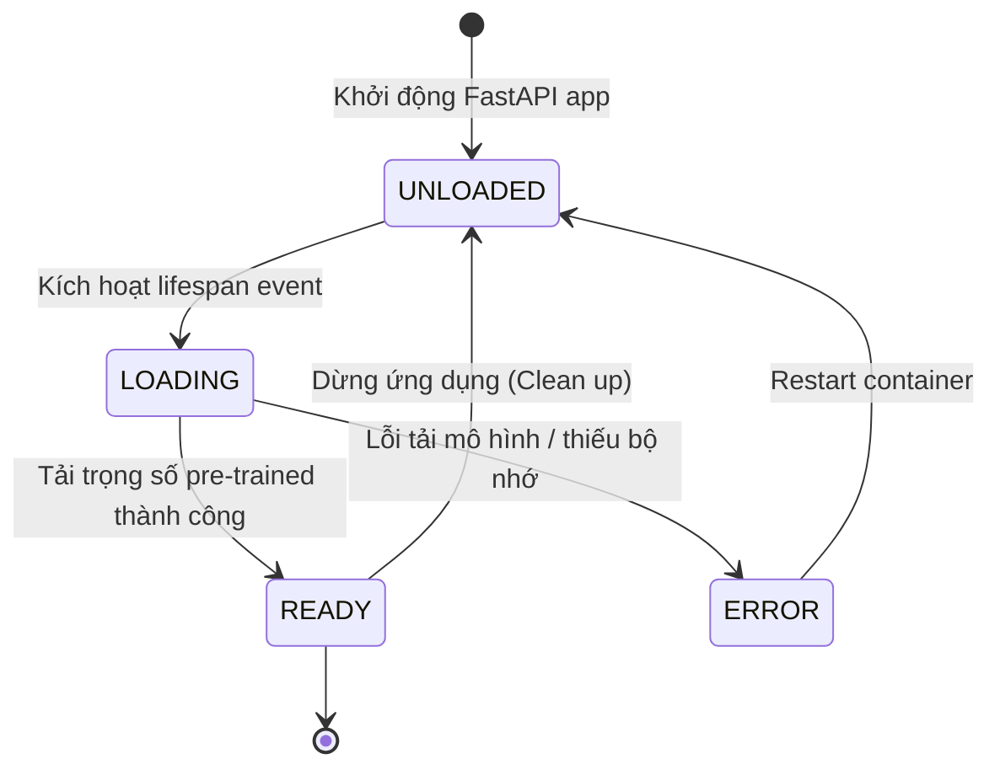
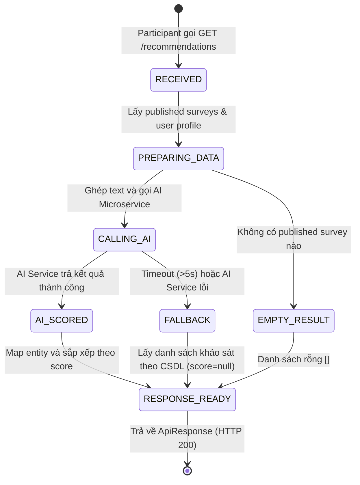

# AI Matching V1 — State Transitions

## 1. Vòng đời mô hình AI (Model Container Lifecycle)

### 1.1. Ý nghĩa trạng thái Model Container

| Trạng thái | Ý nghĩa | Hành động chính được phép |
|---|---|---|
| `UNLOADED` | Mô hình chưa được nạp vào bộ nhớ | Chờ tiến trình lifespan nạp mô hình; Endpoint `/health` báo `model_loaded: false` |
| `LOADING` | Đang tải weights từ bộ nhớ đệm hoặc HuggingFace Hub | Chờ tác vụ hoàn thành; từ chối request suy luận với HTTP 503 |
| `READY` | Mô hình `SentenceTransformer` đã nạp đầy đủ trong RAM | Sẵn sàng nhận và xử lý các yêu cầu vector hóa và so khớp tại `/api/v1/match` |
| `ERROR` | Quá trình nạp trọng số thất bại | Ghi log lỗi nghiêm trọng; Endpoint `/health` báo lỗi; Backend kích hoạt fallback |

### 1.2. Bảng chuyển trạng thái Model

| Trạng thái nguồn | Hành động / Sự kiện | Trạng thái đích | Điều kiện | Side effect |
|---|---|---|---|---|
| `UNLOADED` | Ứng dụng khởi chạy | `LOADING` | FastAPI trigger lifespan startup | Ghi log `Loading SentenceTransformer model...` |
| `LOADING` | Khởi tạo `SentenceTransformer` xong | `READY` | Trọng số mô hình hợp lệ và đủ RAM | Lưu instance vào `model_container["model"]`, ghi log thành công |
| `LOADING` | Gặp lỗi tải weights / OOM | `ERROR` | Ngoại lệ xảy ra trong lúc nạp | Ghi log error, container không chuyển sang healthy |
| `READY` | Ứng dụng nhận lệnh shutdown (SIGTERM) | `UNLOADED` | FastAPI trigger lifespan shutdown | `model_container.clear()`, giải phóng bộ nhớ |

---

## 2. Vòng đời yêu cầu Gợi ý (Recommendation Request Lifecycle)

### 2.1. Ý nghĩa trạng thái yêu cầu

| Trạng thái | Ý nghĩa | Đặc điểm kết quả |
|---|---|---|
| `RECEIVED` | Controller nhận request từ client | Kiểm tra `UserPrincipal` và tham số `limit` |
| `PREPARING_DATA` | Lấy dữ liệu từ database và tạo chuỗi đặc trưng | Chuẩn hóa chuỗi văn bản cho user và các khảo sát `PUBLISHED` |
| `EMPTY_RESULT` | Không có khảo sát nào đang publish | Trả về `[]` ngay lập tức, tiết kiệm tài nguyên mạng/AI |
| `CALLING_AI` | Gửi HTTP POST sang AI Matching Service | Chờ phản hồi với timeout tối đa 5000ms |
| `AI_SCORED` | Nhận ma trận điểm từ AI Engine | Đầy đủ `survey_id` và `score` (0.0 - 1.0) đã sắp xếp |
| `FALLBACK` | Kích hoạt cơ chế phòng vệ khi AI lỗi/timeout | Chuyển sang danh sách khảo sát theo thứ tự CSDL |
| `RESPONSE_READY` | Chuẩn bị dữ liệu trả về cho client | Đóng gói vào `ApiResponse<List<SurveyRecommendationResponse>>` với mã HTTP 200 |

### 2.2. Bảng chuyển trạng thái yêu cầu

| Trạng thái nguồn | Hành động | Trạng thái đích | Điều kiện | Side effect |
|---|---|---|---|---|
| `RECEIVED` | Đọc dữ liệu | `PREPARING_DATA` | Request hợp lệ | Truy vấn `UserProfile`, `UserInterest`, `Survey`, `SurveyTargetInterest` |
| `PREPARING_DATA` | Kiểm tra số lượng | `EMPTY_RESULT` | `publishedSurveys.isEmpty()` | Không gọi sang AI Service, trả về mảng rỗng |
| `PREPARING_DATA` | Tạo DTO | `CALLING_AI` | Có ít nhất 1 published survey | Tạo `AiMatchRequest` và gửi qua `AiMatchingClient` |
| `CALLING_AI` | Nhận phản hồi AI | `AI_SCORED` | HTTP 200 từ AI Service và kết quả hợp lệ | Map `score` vào từng khảo sát tương ứng |
| `CALLING_AI` | Lỗi / Timeout | `FALLBACK` | Exception / Timeout / HTTP 5xx từ AI Service | Ghi log cảnh báo, gán `score = null` |
| `AI_SCORED` / `FALLBACK` | Đóng gói DTO | `RESPONSE_READY` | Hoàn tất mapping danh sách | Trả về `ApiResponse.success(...)` cho client |
