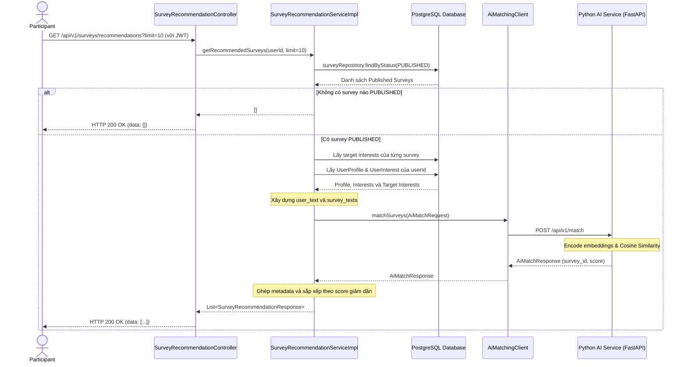
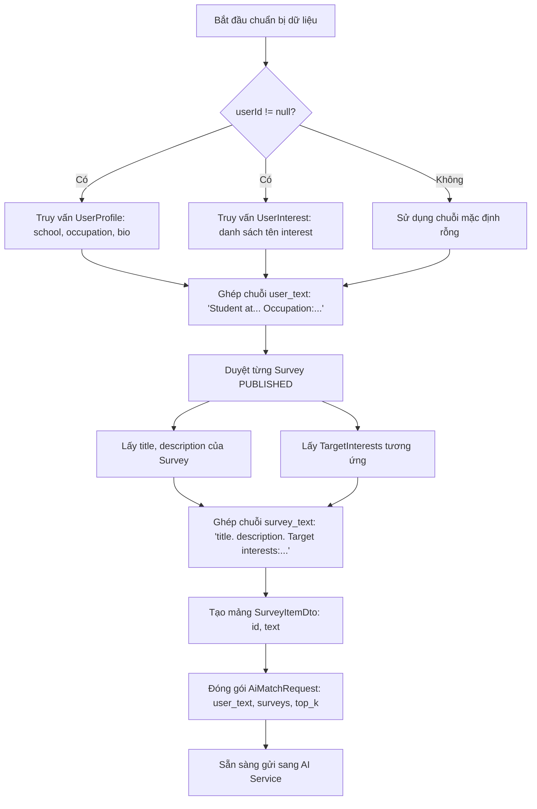
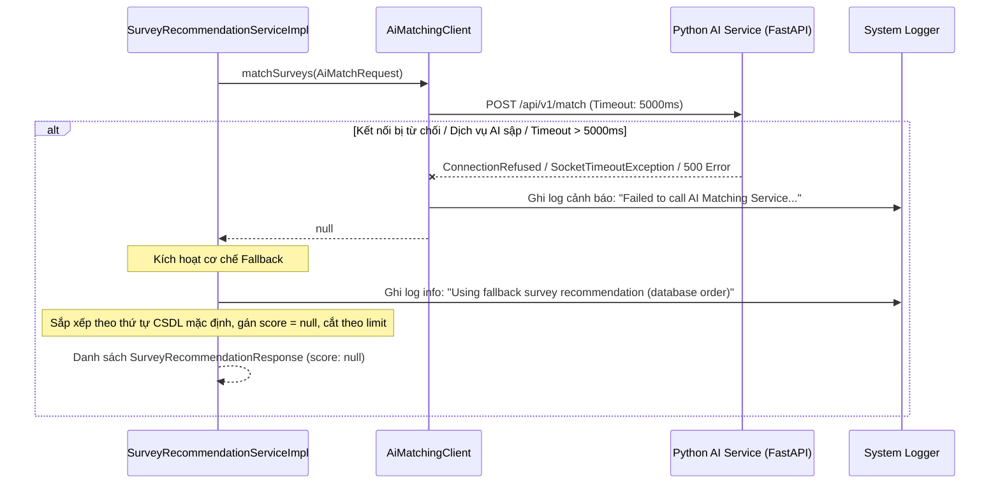

# AI Matching V1 — Business Flows

## 1. Luồng gợi ý khảo sát cá nhân hóa (End-to-End Recommendation Flow)



---

## 2. Luồng tiền xử lý và trích xuất đặc trưng (Text Feature Extraction)



---

## 3. Luồng tính toán suy luận ngữ nghĩa tại Python AI Service

```mermaid
flowchart TD
    A[Nhận POST /api/v1/match] --> B{Mô hình đã load trong model_container?}
    B -- Không --> C[Raise HTTPException 503: Model is not loaded]
    
    B -- Có --> D{request.surveys rỗng?}
    D -- Có --> E[Trả về MatchResponse rỗng results: []]
    
    D -- Không --> F[Lấy model = model_container['model']]
    F --> G[Encode user_text -> user_embedding 1x384]
    G --> H[Batch encode survey_texts -> survey_embeddings Nx384]
    H --> I[Tính cosine_similarity giữa user_embedding và survey_embeddings]
    I --> J[Tạo danh sách SurveyScore: survey_id, score làm tròn 4 chữ số]
    J --> K[Sắp xếp danh sách theo score giảm dần]
    K --> L[Cắt lấy top_k phần tử đầu tiên]
    L --> M[Trả về MatchResponse results: top_results]
```

---

## 4. Luồng xử lý sự cố và tự động Fallback (Graceful Degradation Flow)


