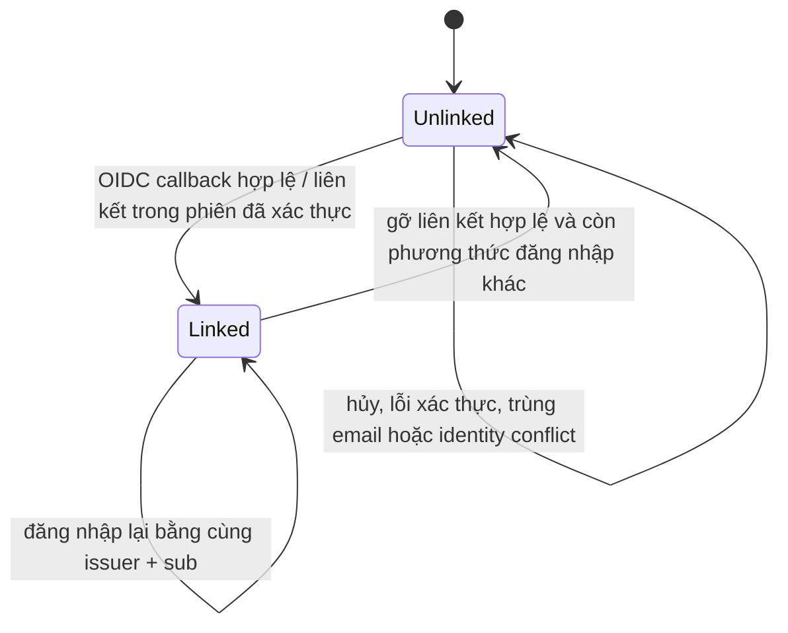
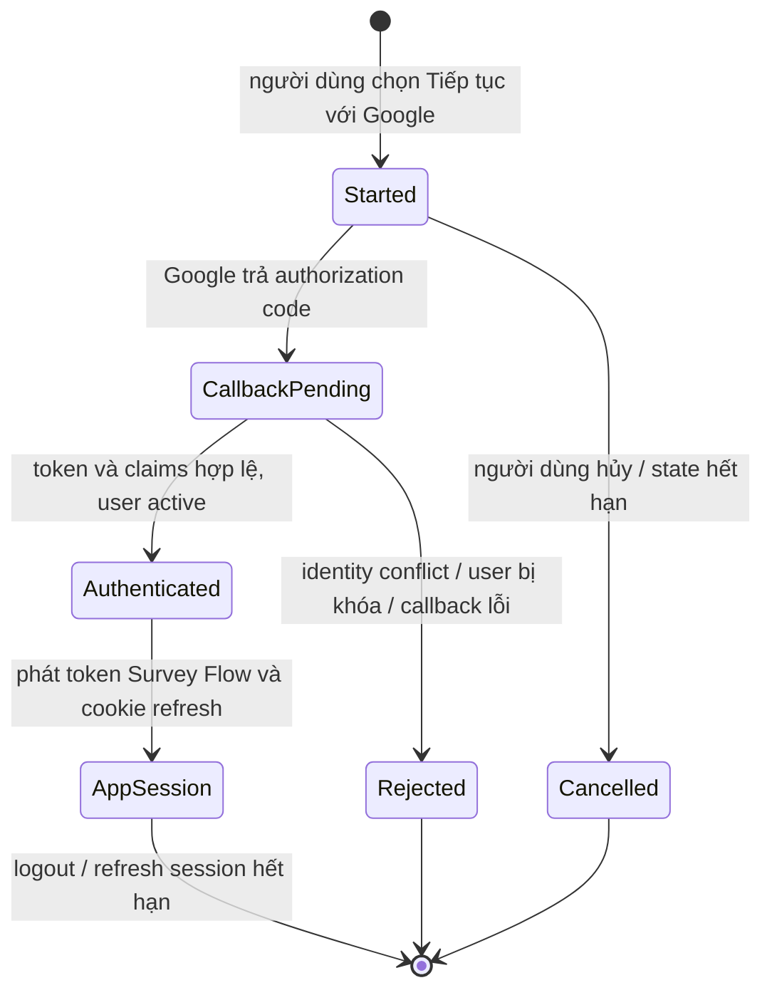

# Google SSO — State Transitions (V1)

## Google identity

| Trạng thái | Ý nghĩa |
|---|---|
| `Unlinked` | Chưa có identity Google gắn với user Survey Flow |
| `Linked` | Identity Google đã gắn với một user duy nhất |

## Phiên đăng nhập

`Authenticated` ở đây là kết quả xác minh provider; chỉ `AppSession` được dùng để gọi API nghiệp vụ.
