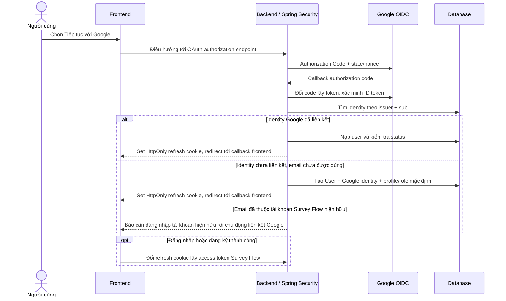
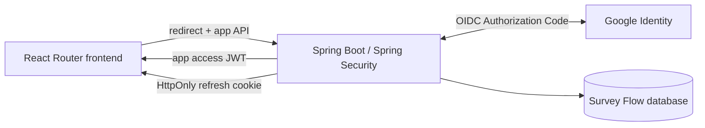

# Google SSO — Business Flows (V1)

## 1. Đăng nhập lần đầu

Người dùng đăng nhập Google mới chỉ thực hiện một lần. Chỉ nhánh email đã gắn với tài khoản Survey Flow khác mới cần đăng nhập tài khoản hiện hữu trước khi chủ động liên kết, để tránh tự động nhập nhầm hai tài khoản.

Tạo user và identity phải atomic; unique constraint trên issuer/subject và email xử lý các request đồng thời. Nếu phát sinh race, nạp lại bản ghi đã tồn tại rồi áp dụng cùng quy tắc conflict.

## 2. Đăng nhập lại

1. Frontend chuyển trình duyệt tới endpoint bắt đầu Google login của backend.
2. Backend tạo/ghi state, nonce và redirect an toàn rồi chuyển người dùng tới Google.
3. Callback backend đổi authorization code, xác minh ID token và tìm identity `(issuer, sub)`.
4. Backend kiểm tra user đang hoạt động, phát app access token và refresh cookie theo cơ chế hiện hành.
5. Frontend gọi `POST /api/v1/auth/refresh` để lấy access token và user, sau đó điều hướng tới `redirectTo` an toàn.

## 3. Liên kết Google với user đã có

1. User đăng nhập bằng phương thức hiện có và chọn liên kết Google.
2. Backend bắt đầu OAuth flow có mục đích `LINK`, gắn với user hiện hành và yêu cầu re-authentication nếu session cũ.
3. Sau callback, backend xác minh token và đảm bảo Google identity chưa thuộc user khác.
4. Backend lưu identity và redirect về frontend; frontend giữ nguyên app session.

## 4. Trường hợp email trùng

Email Google khớp một user local nhưng Google identity chưa gắn: không đăng nhập user đó chỉ nhờ email. Callback hướng dẫn người dùng đăng nhập bằng credential hiện có rồi liên kết Google từ dashboard. Nếu người dùng mất credential, cần dùng luồng khôi phục tài khoản; không merge tự động.

## 5. Sơ đồ thành phần

Frontend không xác minh ID token, không giữ Google token và không tự quyết định identity mapping. Backend là OAuth client và là nơi duy nhất phát hành phiên Survey Flow.
