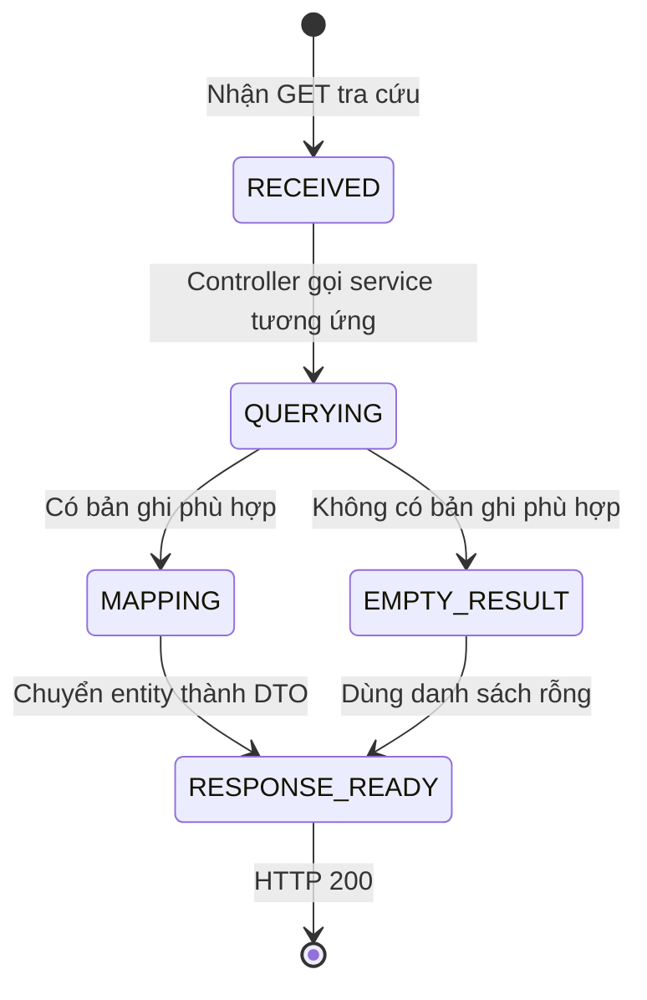

# Metadata V1 — State Transitions

## 1. Trạng thái có trong model

`SurveyCategory`, `Interest` và `Badge` có cờ `is_active`:

| Giá trị | Ý nghĩa với API tra cứu |
|---|---|
| `true` | Bản ghi được trả về nếu tồn tại trong bảng |
| `false` | Bản ghi không được trả về |

Việc thay đổi cờ `is_active` không được cung cấp qua API V1. Bộ tài liệu này không định nghĩa actor, điều kiện hay endpoint để chuyển trạng thái.

## 2. Loại không có trạng thái active

`SurveyTag` và `Level` không có cờ `is_active`. API trả mọi bản ghi trong hai bảng, theo thứ tự quy định ở [Business Rules](./01-business-rules.md).

## 3. Trạng thái người dùng nằm ngoài metadata

Việc nhận badge và tích lũy XP thuộc `UserBadge` và `UserProgress`. Các trạng thái hoặc cập nhật của người dùng không làm thay đổi response định nghĩa badge và level trong bộ API này.

## 4. Vòng đời xử lý request

Các tên bên dưới mô tả tiến trình xử lý để đọc tài liệu; chúng không phải enum hoặc trạng thái được lưu trong database.

### 4.1. Bảng xử lý

| Bước nguồn | Hành động | Bước đích | Điều kiện | Kết quả |
|---|---|---|---|---|
| `RECEIVED` | Gọi service theo domain | `QUERYING` | Đúng endpoint GET | Truy vấn repository |
| `QUERYING` | Đọc kết quả | `MAPPING` | Có bản ghi | Map từng entity thành DTO |
| `QUERYING` | Đọc kết quả | `EMPTY_RESULT` | Không có bản ghi | Danh sách rỗng |
| `MAPPING` / `EMPTY_RESULT` | Bọc `ApiResponse` | `RESPONSE_READY` | Truy vấn thành công | HTTP `200`, `code = SUCCESS` |

Nếu truy vấn phát sinh lỗi, request đi qua cơ chế exception handling chung; không thay đổi dữ liệu danh mục.
