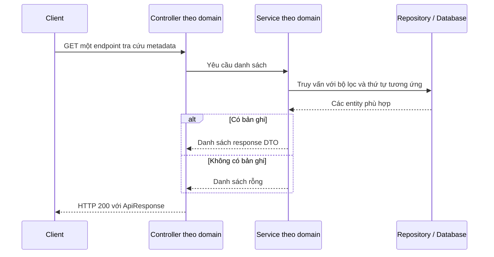
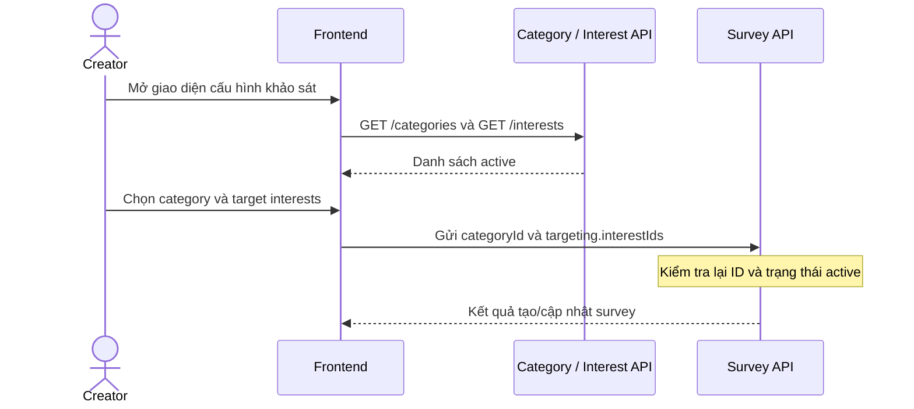

# Metadata V1 — Business Flows

## 1. Tra cứu danh sách

1. Client gọi một endpoint mà không cần access token.
2. Controller tương ứng gọi service riêng của domain đó.
3. Service truy vấn repository với bộ lọc và thứ tự đã khai báo, rồi chuyển entity thành DTO.
4. Controller bọc danh sách trong `ApiResponse`; nếu không có bản ghi, `data` là `[]`.

## 2. Luồng lựa chọn category và target interests

Luồng minh họa cách dùng dữ liệu tham chiếu khi làm giao diện; năm endpoint metadata đã triển khai, còn vị trí page frontend sử dụng chúng chưa được gắn cụ thể. Việc tạo/cập nhật survey tuân theo [Survey API Contract](../survey/04-api-contract.md).

## 3. Luồng tra cứu badge và level

1. Client gọi `GET /api/v1/badges` hoặc `GET /api/v1/levels`.
2. `BadgeService` lấy badge active theo tên; `LevelService` lấy toàn bộ level theo `levelNumber`.
3. Client nhận định nghĩa danh mục để hiển thị tên, mô tả, icon hoặc các mốc XP.
4. Luồng dừng sau khi trả danh sách; không truy vấn `UserBadge` hoặc `UserProgress`, không cấp thưởng cho user.

## 4. Sử dụng ở frontend

Frontend ghép đường dẫn từ `VITE_API_BASE_URL` (mặc định `http://localhost:8080/api/v1`) và path tương ứng. `metadataApi` bóc trường `data` khỏi envelope; mỗi danh sách có query key và TanStack Query hook riêng. Khi bật mock mode, API client dùng dữ liệu mẫu cùng kiểu mà không gọi backend.

| Danh sách | API client | Query hook |
|---|---|---|
| Category | `metadataApi.getCategories()` | `useCategoriesQuery()` |
| Interest | `metadataApi.getInterests()` | `useInterestsQuery()` |
| Tag | `metadataApi.getTags()` | `useTagsQuery()` |
| Badge | `metadataApi.getBadges()` | `useBadgesQuery()` |
| Level | `metadataApi.getLevels()` | `useLevelsQuery()` |

Các API này chỉ trả định nghĩa tham chiếu. Thông tin badge đã nhận, XP hiện tại và level của một người dùng cần lấy từ API người dùng khi được triển khai.
