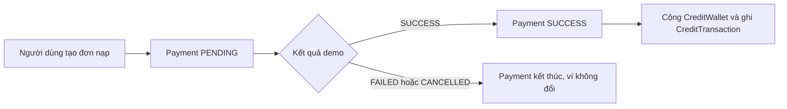

# Payment Demo — Credit top-up

## Phạm vi hiện tại

Luồng demo cho phép người dùng đã đăng nhập tạo đơn nạp Credits và tự chọn kết quả thanh toán trên **dev hoặc staging**, không chuyển tiền thật. Đây là luồng `CREDIT_TOPUP` với provider `DEMO`; tỷ lệ đang cố định ở backend là **1.000 VNĐ = 10 Credits** (100 VNĐ/Credit).

Luồng này không mua subscription, không dùng Credits để thanh toán, không rút tiền và không kết nối PayOS, VNPay hay ngân hàng. Những việc đó được thiết kế ở giai đoạn production hoặc feature riêng.

## Bản ghi và trách nhiệm

| Thành phần | Vai trò trong demo |
| --- | --- |
| `payments` | Một đơn nạp đồng thời là một lần thanh toán demo; lưu người mua, số Credits đặt mua, số tiền VND, provider và trạng thái. |
| `credit_wallets` | Số dư Credits của người dùng. |
| `credit_transactions` | Sổ cái biến động ví; chỉ có bản ghi `CREDIT_TOPUP` khi đơn thành công. `payment_id` liên kết duy nhất đến đơn nạp. |

`payments.credit_amount` và `payments.amount` là giá trị đã chốt khi tạo đơn. Nếu tỷ lệ đổi về sau, đơn cũ vẫn giữ số Credits và số tiền ban đầu. `credit_transactions` ghi số Credits **thực sự đã cộng**, không phải lịch sử thử thanh toán thất bại.

## Tài liệu

1. [Quy tắc nghiệp vụ](01-business-rules.md)
2. [Trạng thái và luồng xử lý](02-state-transitions.md)
3. [API contract](03-api-contract.md)
4. [Cấu hình staging và hướng dẫn kiểm thử](04-staging-runbook.md)

## Ranh giới trước production

Hiện tại một `payment` tương ứng một lần checkout demo. Chưa có bảng riêng cho các lần thử thanh toán, webhook/callback của cổng, đối soát hay hoàn tiền. Trước khi thêm PayOS, cần quyết định cách tách đơn nạp với các lần thử qua cổng và cơ chế xác thực kết quả từ provider. Endpoint `demo-result` chỉ tồn tại khi bật `dev` hoặc `staging` mà không bật `prod`; nó không phải callback production.
