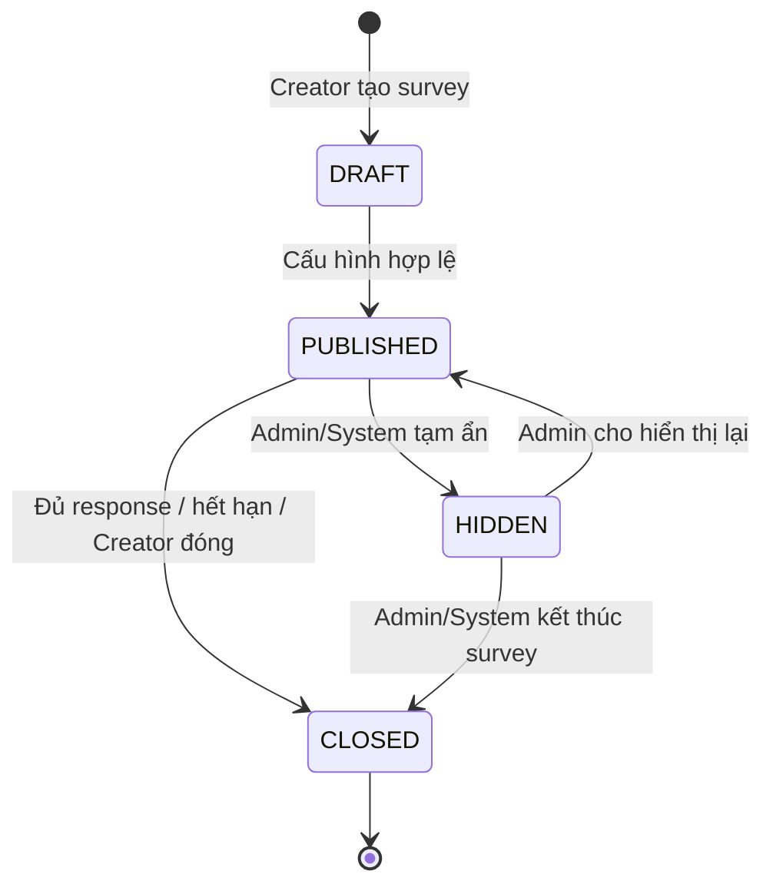
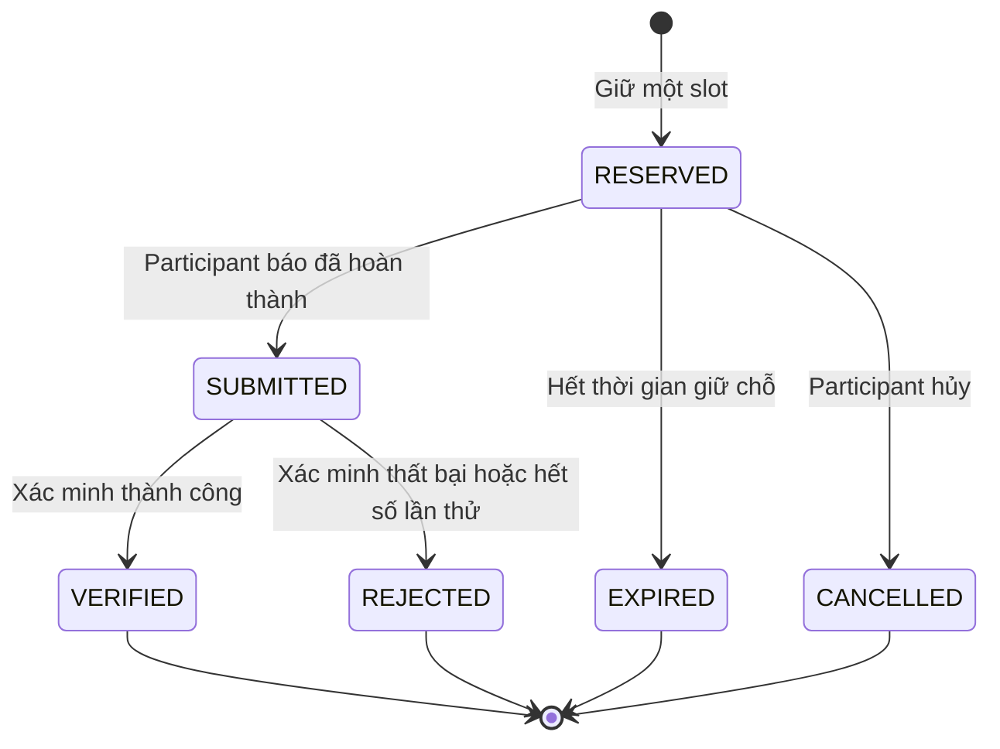

# Survey V1 — State Transitions

## 1. Vòng đời Survey

### 1.1. Ý nghĩa trạng thái

| Trạng thái | Ý nghĩa | Hành động chính được phép |
|---|---|---|
| `DRAFT` | Survey đang được soạn | Sửa nội dung, targeting, tag và verification; không đổi target đã tính phí |
| `PUBLISHED` | Survey đang nhận người tham gia | Hiển thị, matching, giữ chỗ, tham gia hoặc đóng |
| `HIDDEN` | Admin/System tạm ngừng phân phối nhưng chưa kết thúc | Admin xem xét, mở hiển thị lại hoặc đóng |
| `CLOSED` | Survey đã kết thúc | Chỉ đọc kết quả và lịch sử participation |

### 1.2. Chuyển trạng thái

| Trạng thái nguồn | Hành động | Trạng thái đích | Điều kiện chính | Side effect |
|---|---|---|---|---|
| Chưa tồn tại | Creator tạo survey | `DRAFT` | Creator hợp lệ và đủ phí tạo | Trừ `11 × targetResponseCount` credit |
| `DRAFT` | Publish | `PUBLISHED` | Đủ dữ liệu publish | Đặt `publishedAt` |
| `PUBLISHED` | Admin/System ẩn | `HIDDEN` | Có lý do kiểm duyệt hoặc sự cố | Ngừng phân phối và ngừng nhận reservation mới |
| `HIDDEN` | Admin khôi phục | `PUBLISHED` | Survey vẫn hợp lệ và chưa quá deadline | Cho phép phân phối và nhận reservation mới |
| `PUBLISHED` | Creator đóng sớm | `CLOSED` | Creator sở hữu survey | Ngừng nhận reservation mới |
| `PUBLISHED` | System đóng | `CLOSED` | Đủ response hoặc quá deadline | Ngừng nhận reservation mới |
| `HIDDEN` | Admin/System đóng | `CLOSED` | Quyết định kết thúc survey | Ngừng phân phối vĩnh viễn |

`CLOSED` là trạng thái cuối.

### 1.3. Điều kiện publish

- Creator là chủ sở hữu survey và tài khoản được phép tạo survey.
- Có `title`, `provider`, `targetResponseCount` và deadline hợp lệ nếu deadline được cấu hình.
- Provider bên ngoài có URL form hợp lệ.
- Nếu dùng `EXTERNAL_CODE`, Google Form đã cấu hình code question, Apps Script webhook và webhook token hợp lệ.
- Kiểm tra kết nối webhook thành công trước khi publish.
- Có một verification config đang hiệu lực.
- `targetResponseCount > 0`.

## 2. Vòng đời Participation

### 2.1. Ý nghĩa trạng thái

| Trạng thái | Ý nghĩa |
|---|---|
| `RESERVED` | Participant đã giữ một slot và chưa báo hoàn thành |
| `SUBMITTED` | Participant đã báo hoàn thành và đang chờ hoặc đang được xác minh |
| `VERIFIED` | Kết quả hợp lệ, được tính response và nhận reward |
| `REJECTED` | Kết quả không hợp lệ hoặc đã hết số lần xác minh |
| `EXPIRED` | Slot hết hạn trước khi submit |
| `CANCELLED` | Participant chủ động hủy trước khi submit |

### 2.2. Chuyển trạng thái

| Trạng thái nguồn | Hành động | Trạng thái đích | Điều kiện chính | Side effect |
|---|---|---|---|---|
| Chưa tồn tại | Reserve | `RESERVED` | Survey nhận participation, user eligible và còn capacity | Snapshot eligibility và verification config; giữ một slot |
| `RESERVED` | Nhận form webhook | `SUBMITTED` | Webhook hợp lệ, code khớp và form được submit trong thời hạn slot | Ghi `submittedAt`, response ID và bắt đầu xác minh |
| `RESERVED` | Hết hạn | `EXPIRED` | `slotExpiresAt <= now` | Trả slot về capacity |
| `RESERVED` | Participant hủy | `CANCELLED` | Slot chưa được submit | Trả slot về capacity |
| `SUBMITTED` | Xác minh thành công | `VERIFIED` | Đáp ứng verification config | Ghi `verifiedAt`, tăng response count và phân phối reward |
| `SUBMITTED` | Xác minh thất bại cuối cùng | `REJECTED` | Hết số lần thử hoặc Reviewer từ chối | Ghi `rejectedAt`, `failureReason` và trả slot về capacity |

`VERIFIED`, `REJECTED`, `EXPIRED` và `CANCELLED` là các trạng thái cuối của một participation.

### 2.3. Quy tắc giữ chỗ

- Chỉ tạo reservation khi survey còn nhận response và Participant đủ điều kiện.
- Khi reserve, hệ thống snapshot version cấu hình xác minh.
- `slotExpiresAt = slotReservedAt + slotTtlSeconds`.
- Kiểm tra capacity và tạo participation phải nằm trong cùng transaction.
- Slot `EXPIRED` hoặc `CANCELLED` không chiếm capacity sau khi được xử lý.

### 2.4. Quy tắc submit và xác minh

- Với `EXTERNAL_CODE`, Participant không trực tiếp báo hoàn thành với Survey Flow; Google Apps Script webhook xác nhận Google Form đã được submit.
- Completion code chỉ được phát hành sau `slotReservedAt + minCompletionSeconds`.
- `estimatedDurationSeconds` không tham gia quyết định phát hành hoặc xác minh code.
- Chỉ participation `RESERVED` có form submission hợp lệ trong thời hạn slot mới được chuyển sang `SUBMITTED`.
- Mỗi lần xác minh thất bại tăng `verificationAttemptCount`.
- Khi đạt `maxAttempts`, participation chuyển `REJECTED` và lưu `failureReason`.
- `EXTERNAL_CODE`: Participant nhập completion code do Survey Flow phát hành vào Google Form; backend đối chiếu hash khi nhận webhook.
- `MANUAL_REVIEW`: submission chờ Reviewer/Admin quyết định.
- Chỉ transition sang `VERIFIED` mới được tính là response thành công và nhận thưởng.
- Mỗi participation `VERIFIED` nhận cố định 10 credit từ hệ thống.
