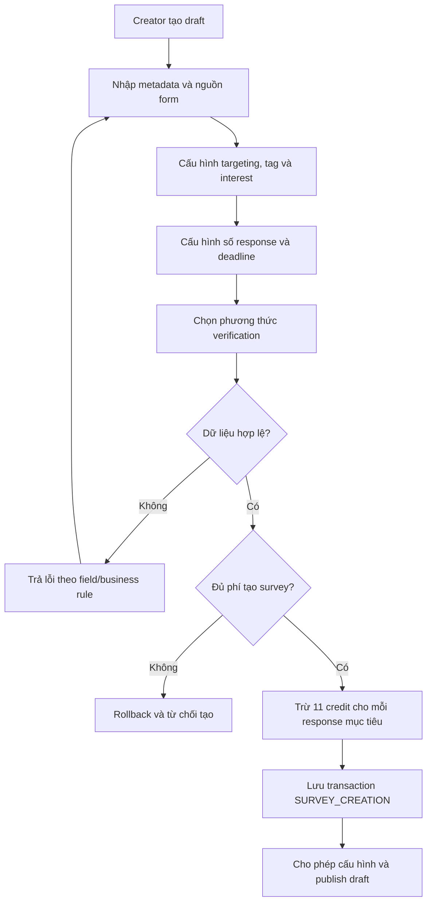
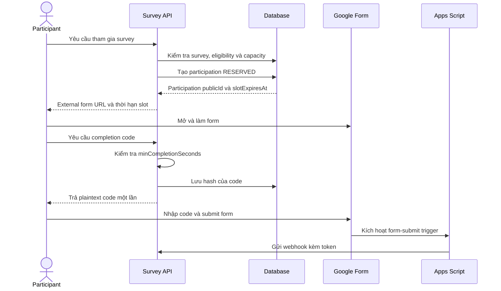
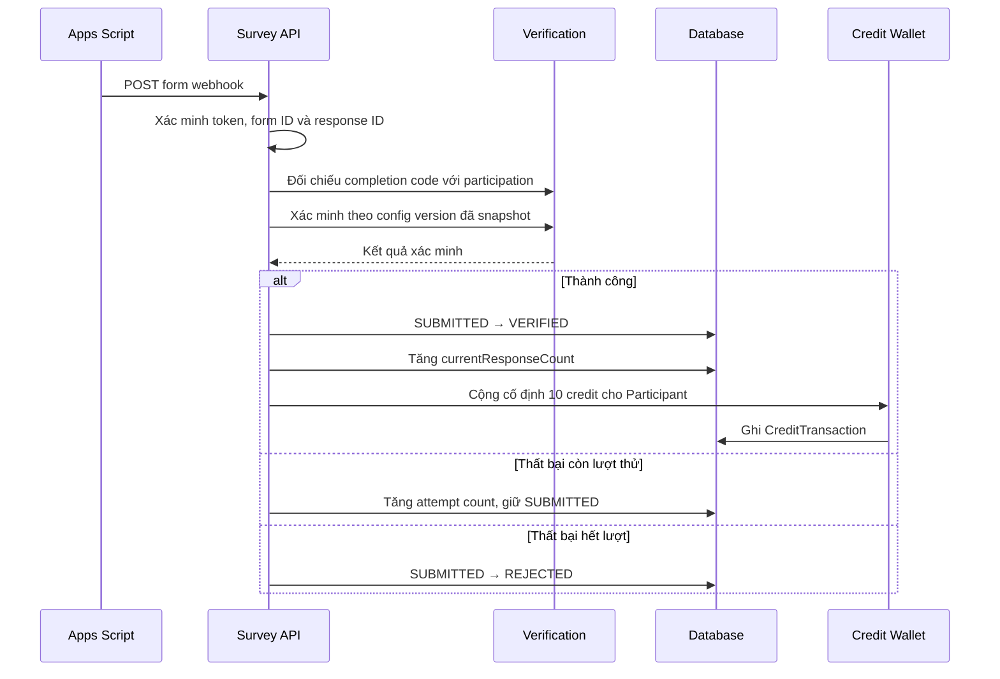

# Survey V1 — Business Flows

## 1. Cấu hình Google Form

Trước khi publish survey dùng `EXTERNAL_CODE`, Creator thực hiện các bước sau:

1. Tạo một câu hỏi bắt buộc để nhận completion code trên Google Form.
2. Cài Apps Script template của Survey Flow vào form.
3. Cài installable form-submit trigger cho script.
4. Cấu hình survey ID, webhook URL và webhook token cho script.
5. Chạy kiểm tra kết nối để xác nhận backend nhận và xác thực được webhook.

Survey không được publish nếu kiểm tra kết nối thất bại.

## 2. Tạo và publish Survey

Khi tạo và publish thành công:

- Phí tạo survey được trừ một lần khi tạo draft.
- `publishedAt` được ghi nhận.
- Survey bắt đầu xuất hiện trong discovery/matching nếu còn thời hạn và capacity.
- Participation lưu `verificationConfigVersion` đang hiệu lực tại thời điểm giữ chỗ.

## 3. Khám phá và kiểm tra eligibility

Một survey chỉ được đưa vào danh sách hoặc matching khi:

- Có trạng thái `PUBLISHED`.
- Chưa quá deadline.
- Còn capacity sau khi tính response đã xác minh, reservation còn hiệu lực và submission đang chờ xác minh.
- Participant không phải Creator của survey.
- Participant thỏa targeting bắt buộc.
- Participant không có participation `RESERVED`, `SUBMITTED`, `VERIFIED` hoặc `REJECTED` trước đó.
- Participation mới chỉ được phép nếu participation gần nhất là `EXPIRED` hoặc `CANCELLED`.

Kết quả eligibility tại thời điểm giữ chỗ được lưu vào `eligibilitySnapshot` để phục vụ audit, ngay cả khi profile người dùng thay đổi sau đó.

## 4. Giữ chỗ, nhận code và hoàn thành Google Form

Việc kiểm tra capacity và tạo participation phải atomic. Nếu transaction thất bại, hệ thống không được giữ slot.

`estimatedDurationSeconds` chỉ được hiển thị cho Participant. Backend sử dụng `minCompletionSeconds` để quyết định thời điểm cho phép phát hành completion code.

## 5. Xác minh và trả thưởng

Các cập nhật sau phải atomic hoặc sử dụng cơ chế idempotency/outbox tương đương:

- Participation chuyển sang `VERIFIED`.
- `currentResponseCount` tăng đúng một lần.
- Ví Participant được cộng credit đúng một lần.
- `CreditTransaction` loại `SURVEY_COMPLETION` được tạo đúng một lần cho participation.

## 6. Đóng Survey

Survey chuyển thành `CLOSED` khi xảy ra một trong các điều kiện:

- Số response đã xác minh đạt `targetResponseCount`.
- Deadline đã qua.
- Creator đóng survey sớm.
- Admin/System kết thúc survey đang `HIDDEN`.

Sau khi survey đóng:

1. Không nhận reservation mới.
2. Participation `RESERVED` còn hạn được phép tiếp tục đến khi submit, hết hạn hoặc bị hủy.
3. Participation `SUBMITTED` tiếp tục được xác minh.

## 7. Xử lý tự động

- Job expiry chuyển reservation quá hạn từ `RESERVED` sang `EXPIRED`.
- Job deadline chuyển survey quá hạn từ `PUBLISHED` sang `CLOSED`.
- Hệ thống đóng survey ngay khi response đã xác minh đạt target.
- Tác vụ trả thưởng có thể được retry nhưng không được tạo reward hoặc transaction trùng lặp.
- Apps Script template phải lưu callback gửi thất bại và retry; backend xử lý các lần gửi lại theo response ID một cách idempotent.
