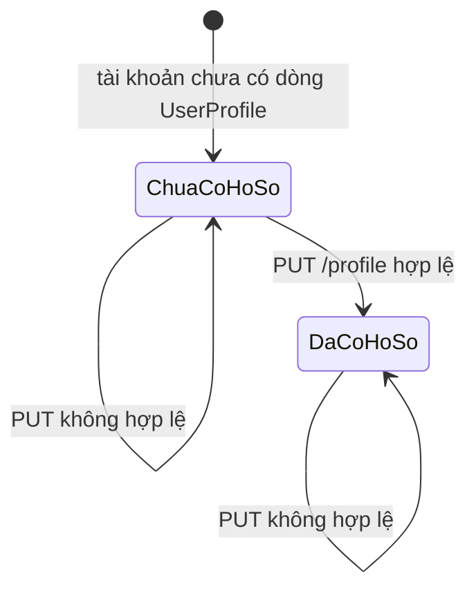
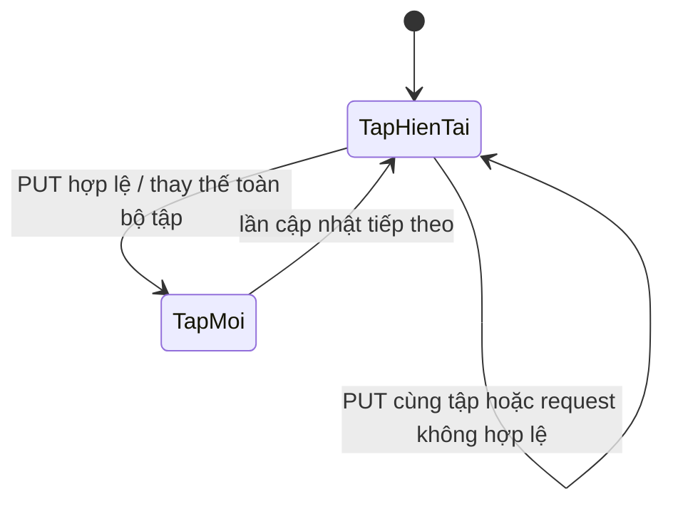

# Users V1 — State Transitions

Hồ sơ và sở thích không có enum trạng thái vòng đời. Sơ đồ dưới đây mô tả trạng thái dữ liệu sau các thao tác API.

## Hồ sơ

| Trạng thái | Ý nghĩa |
|---|---|
| `ChuaCoHoSo` | User tồn tại; các trường hồ sơ được trả là `null`. |
| `DaCoHoSo` | Có một dòng `UserProfile`; các trường riêng lẻ vẫn có thể là `null`. |

`PUT` không xóa dòng `UserProfile`; giá trị `null` hoặc trường không gửi xóa giá trị tương ứng. Client gửi đầy đủ sáu trường có thể sửa khi lưu.

## Sở thích

`TapHienTai` và `TapMoi` có thể là tập rỗng. Request không hợp lệ không được xóa một phần tập cũ. Interest bị vô hiệu hóa không tự động xóa khỏi tập đã lưu; nó chỉ không còn hợp lệ cho lần chọn tiếp theo.
