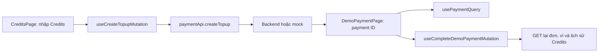

# Tích hợp frontend và API

## Luồng dữ liệu

| Thành phần                                                                   | Trách nhiệm                                                                                     |
| ---------------------------------------------------------------------------- | ----------------------------------------------------------------------------------------------- |
| `app/pages/CreditsPage/CreditsPage.tsx`                                      | Nhận số Credits, ước tính VND, tạo đơn và điều hướng bằng ID trả về.                            |
| `app/routes.ts`, `app/routes/demo-payment.tsx`, `app/pages/DemoPaymentPage/` | Khai báo route protected, tải và hiển thị checkout của một đơn.                                 |
| `app/apis/payment.api.ts`                                                    | Chọn mock hoặc gọi backend; unwrap `ApiResponse<T>`. Không tự chuyển sang mock nếu backend lỗi. |
| `app/hooks/queries/payment/use-payment-queries.ts`                           | Query chi tiết, mutation tạo/chốt đơn và làm mới cache.                                         |
| `app/mocks/payment.mock.ts`                                                  | Giữ đơn demo trong `Map`; chỉ kết quả thành công gọi mock ví để cộng Credits.                   |
| `app/types/payment.type.ts`                                                  | Kiểu `TopupPayment` và ba kết quả demo.                                                         |

## Ba lời gọi API

Khi `VITE_ENABLE_MOCK=false`, `paymentApi` dùng HTTP client chung với base URL `VITE_API_BASE_URL`, access token và cơ chế refresh phiên của ứng dụng:

| Hành động    | Request                                                                                            | Dữ liệu frontend sử dụng                                 |
| ------------ | -------------------------------------------------------------------------------------------------- | -------------------------------------------------------- |
| Tạo đơn      | `POST /payments/topups` với `{ "credits": 11 }`                                                    | `id` để điều hướng; đơn mới ở trạng thái `PENDING`.      |
| Xem đơn      | `GET /payments/{paymentId}`                                                                        | `credits`, `amountVnd`, `status`, `createdAt`, `paidAt`. |
| Chọn kết quả | `POST /payments/{paymentId}/demo-result` với `{ "outcome": "SUCCESS" }` hoặc `FAILED`, `CANCELLED` | Trạng thái cập nhật; chỉ `SUCCESS` cộng ví ở backend.    |

Đường dẫn trên nối vào base URL `/api/v1`; ví dụ request tạo đơn đầy đủ là `POST /api/v1/payments/topups`. API contract, mã lỗi và tính lặp chuẩn nằm trong [docs backend](../../../../survey_flow-backend/docs/payment/demo/03-api-contract.md).

## Cache và giới hạn

Chi tiết đơn dùng query key `['payments', paymentId]`. Sau mutation chọn kết quả thành công, hook invalidate key đó cùng `['credits', 'wallet']` và `['credits', 'transactions']`. Trang checkout refetch trạng thái; khi quay lại `/credits`, ví và lịch sử nhận dữ liệu mới. Mutation tạo đơn không cập nhật ví vì payment vẫn `PENDING`.

Trang ví hiển thị **lịch sử biến động Credits**, không phải lịch sử mọi payment. Vì vậy chỉ `SUCCESS` tạo dòng nạp Credits; `FAILED` và `CANCELLED` được xem qua URL đơn tương ứng. Mock dùng cùng kiểu response và luồng query/mutation, nhưng không thay thế kiểm thử backend, database hoặc phân quyền.
